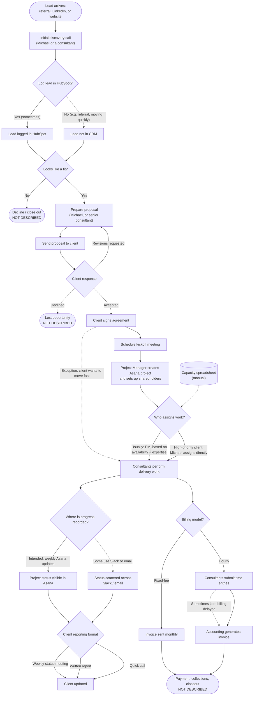

# Task 1 — Process Discovery Analysis

**Engagement:** Client delivery standardization
**Source:** One discovery call with Michael Reynolds, Managing Partner
**Prepared by:** Astha Mehra

**Labeling convention used throughout all deliverables**

| Label | Meaning |
|---|---|
| **[Fact]** | Stated directly in the transcript |
| **[Assumption]** | My inference; not yet validated with the client |
| **[Gap]** | Information we do not have |

---

## 1A. Process Summary

### Purpose of the process

Take a client engagement from first contact through delivery and payment, in three phases:

1. **Win the work:** lead intake, discovery call, proposal, agreement.
2. **Deliver the work:** kickoff, project setup, staffing, task tracking, client updates.
3. **Get paid:** time entry and invoicing.

The stated business goal is a *"more standardized delivery process from sales through project completion"* so the firm spends less time coordinating and chasing information and more time delivering client value. **[Fact]**

### Key stakeholders

| Stakeholder | Role in the process | Status |
|---|---|---|
| Michael Reynolds (Managing Partner) | Takes discovery calls, writes most proposals, sometimes assigns work directly for high-priority clients | **[Fact]** |
| Consultants (incl. senior consultants) | Take discovery calls, write some proposals, do the delivery work, update tasks, submit time entries | **[Fact]** |
| Project Manager(s) | Create the Asana project and shared folders, usually assign tasks | **[Fact]** (number of PMs unknown) |
| Clients | Reach out, sign the agreement, approve or revise proposals, receive status updates | **[Fact]** |
| Accounting | Generates invoices for hourly projects from time entries | **[Fact]** |
| Referral sources / LinkedIn / website | Lead channels | **[Fact]** |
| Who sends invoices on fixed-fee projects | Unclear | **[Gap]** |
| Who owns the agreement or contract | Unclear (Legal? Michael? Ops?) | **[Gap]** |

### Systems and tools referenced

| System | Used for | Observed consistency |
|---|---|---|
| HubSpot | Lead / CRM logging | Inconsistent; skipped for fast-moving referrals |
| Asana | Project setup, task assignment, progress tracking | Inconsistent; consultants update "weekly" but some use Slack or email instead |
| Google Drive | Shared folders, documentation | One of several documentation locations |
| Spreadsheet | Capacity tracking (no formal resource planning) | Manual |
| Slack | Informal progress updates | Ad hoc |
| Email | Informal progress updates, documentation | Ad hoc |
| Meetings / calls | Discovery, kickoff, weekly status | Format varies by client |
| Accounting system | Invoice generation | **[Gap]** tool name unknown |
| Time-tracking mechanism | Hourly time entries | **[Gap]** tool unknown |
| E-signature / contract tool | Agreement signing | **[Gap]** unknown |
| Proposal tool / template | Proposal creation | **[Gap]** "format mostly the same," tool unknown |

### Major process stages

1. Lead intake
2. Initial discovery call
3. Fit assessment
4. Proposal creation
5. Proposal delivery, revision, and approval
6. Agreement signing
7. Kickoff scheduling and project setup (Asana, shared folders)
8. Work assignment / resourcing
9. Delivery and progress tracking
10. Client status reporting
11. Time capture and billing (fixed-fee monthly; hourly via time entries)
12. Project completion / closeout: **not discussed [Gap]**

### Inputs and outputs by stage

| # | Stage | Inputs | Outputs |
|---|---|---|---|
| 1 | Lead intake | Referral / LinkedIn / website inquiry | Lead (sometimes a HubSpot record) |
| 2 | Discovery call | Lead contact details, client need | Understanding of needs; call notes **[Assumption: notes exist; location unknown]** |
| 3 | Fit assessment | Call outcome | Go / no-go decision |
| 4 | Proposal creation | Discovery notes, internal pricing knowledge **[Assumption]** | Proposal document |
| 5 | Proposal approval | Proposal | Approved proposal or revision requests |
| 6 | Agreement signing | Approved proposal | Signed agreement |
| 7 | Kickoff / setup | Signed agreement | Kickoff meeting, Asana project, shared folders |
| 8 | Work assignment | Project scope, consultant availability and expertise, capacity spreadsheet | Assigned Asana tasks |
| 9 | Delivery / tracking | Assigned tasks | Deliverables, updated tasks (or Slack / email updates) |
| 10 | Client reporting | Project status | Weekly meeting, written report, or call (varies) |
| 11 | Billing | Time entries (hourly) or fixed-fee schedule | Invoices |

### Important decision points

| # | Decision | Decider | Options stated |
|---|---|---|---|
| D1 | Log the lead in HubSpot? | Michael / consultant (ad hoc) | Yes now / not at all if referral and moving fast |
| D2 | Who takes the discovery call? | Michael or a consultant | Either |
| D3 | Is it a fit? | **[Gap]** | Proceed to proposal / not described |
| D4 | Who writes the proposal? | Michael (usually) or senior consultant | Either |
| D5 | Does the client accept or request revisions? | Client | Accept / revise (decline not described) |
| D6 | Start work before setup is complete? | Consultant / client pressure | Follow process / start early |
| D7 | Who assigns work? | PM (usually) or Michael (high-priority clients) | Either |
| D8 | Where are updates recorded? | Individual consultant | Asana / Slack / email |
| D9 | What reporting format does the client get? | Varies by client | Weekly meeting / written report / quick call |
| D10 | Billing model | Set by engagement | Fixed-fee (monthly invoice) / hourly (time entries) |

---

## 1B. Information Gaps

### Missing information not covered in the transcript

**Lead intake and qualification**
- What defines "a fit"? Are there written criteria (size, industry, budget, capacity)?
- How are leads qualified or prioritized? Who decides to decline?
- What is lost-lead handling, and is the reason for losing tracked?

**Proposal and pricing**
- How are scope, price, and timeline determined? Is there a pricing model or rate card?
- Is there an internal review or approval before a proposal goes out? Are there approval thresholds?
- Are there proposal templates, and where do they live?
- How are revisions versioned? Is there a limit on rounds?

**Contracting**
- Who drafts and sends the agreement? Which tool is used? Are there standard terms (MSA / SOW)?
- Is there a payment-terms standard (net 30, deposits, milestones)?
- Is a signed agreement truly required before work starts? What happens when it isn't?

**Project setup and staffing**
- Is there an Asana template and a Drive folder template? What is the standard folder structure?
- Who is the PM on each project: dedicated or shared across projects? How many PMs exist?
- How is capacity actually tracked, who owns the spreadsheet, and how current is it?
- How does a consultant's expertise get matched to work: skills matrix or tribal knowledge?

**Delivery and tracking**
- What does "update tasks weekly" actually mean in practice? Is it enforced or reviewed?
- How are scope changes, risks, and issues recorded and escalated?
- What are the project-level quality checks or deliverable reviews?

**Client communication**
- Who runs the weekly status meeting? Who writes written reports, and from what source?
- Is there a standard report template?

**Billing**
- Which accounting and time-tracking systems are used?
- What is the cutoff for time entries? What counts as "late" and how often does it happen?
- Who prepares and sends fixed-fee invoices? How are expenses handled?
- How are billing disputes, write-offs, and collections handled?

**Closeout and governance**
- What happens at project completion (closeout, retrospective, final invoice, archiving, testimonial)?
- Is there any KPI tracking (utilization, margin, time-to-kickoff, DSO, client satisfaction)?
- How does the firm currently know whether "everyone is following the same process"?

### Unclear responsibilities or ownership

| Area | Ambiguity |
|---|---|
| Lead logging | "Sometimes we log the lead... sometimes we don't": no single owner |
| Proposal creation | Michael *or* senior consultants; no named owner or reviewer |
| Agreement / contract | No owner mentioned at all |
| Project setup | PM creates it, but who verifies it is complete before work starts? |
| Work assignment | PM *or* Michael; unclear when Michael overrides and whether the PM is informed |
| Capacity spreadsheet | No owner named |
| Progress updates | Consultant responsibility, but no enforcement or reviewer described |
| Client reporting | Owner and format undefined |
| Time entry compliance | Consultants submit, accounting waits; who chases? |
| Fixed-fee invoicing | Owner not stated |
| Process governance | Nobody appears to own the standard process itself |

### Assumptions I am making that cannot yet be validated

| # | Assumption | How I would validate |
|---|---|---|
| A1 | The firm is small to mid-size (a handful of consultants, 1–few PMs) | Ask headcount and project volume |
| A2 | "Project manager" is a distinct role, not a hat worn by consultants | Org chart; ask who PMs are |
| A3 | A signed agreement precedes billable work in the intended process | Review contract policy |
| A4 | The kickoff meeting occurs before or alongside Asana setup (order not stated) | Ask PM |
| A5 | Discovery call notes are captured somewhere (HubSpot, Drive, personal notes) | Ask where |
| A6 | Proposals contain scope, fee, and timeline | Review 2–3 recent proposals |
| A7 | Lost / declined opportunities exist but aren't formally tracked | Ask about win rate tracking |
| A8 | Clients who decline a proposal exit the process (not described) | Ask |
| A9 | Fixed-fee invoicing is calendar-monthly regardless of milestone | Ask |
| A10 | Accounting is a separate person or function from Michael and the PMs | Ask |
| A11 | Project closeout exists informally but isn't standardized | Ask |
| A12 | Michael's perception of "too much coordination" is accurate but unmeasured | Time study or survey |

---

## 1C. Follow-Up Questions for the Next Stakeholder Session

### Lead intake and qualification
1. What percentage of leads come from each channel (referral, LinkedIn, website)? Do they need different handling?
2. When a lead is *not* logged in HubSpot, where does the information live? How often does it end up never being logged?
3. What criteria decide whether a lead is "a fit"? Is that written down, or judgment?
4. Who can decline a lead, and how is the client told?
5. How do you currently measure conversion from lead to signed client?

### Proposals
6. Can I see 2–3 recent proposals from different authors? Where do they differ most?
7. Who determines price and scope? Is there a rate card or pricing guideline?
8. Does anyone review a proposal before it is sent? Does that differ for large deals?
9. What typically triggers client revisions, and who approves the changes? Is there a limit?
10. How are won and lost proposals stored so they can be reused?

### Contracting and kickoff
11. Who prepares the agreement, which tool is used, and are terms standard?
12. When consultants start before setup is complete, what is typically missing? What risks has that caused?
13. Who authorizes an early start? Is it ever formally approved?
14. What is the standard kickoff agenda, and who runs it?
15. Is there an Asana template and Drive folder standard today, even informal?

### Staffing and resourcing
16. How many PMs and consultants are there, and how many active projects at any time?
17. How is the capacity spreadsheet maintained, how current is it, and who reads it?
18. When Michael assigns work directly, does the PM find out? Has this caused conflicts?
19. What criteria decide who is staffed (skills, availability, client relationship)?
20. Have you experienced overbooking or idle time? How was it discovered?

### Delivery and tracking
21. What should a "good" Asana update look like? Who checks for compliance?
22. Where do deliverables, meeting notes, and client documents *belong* in the ideal state?
23. How are scope changes, risks, and blockers raised and recorded?
24. What are examples of "chasing information"? Who chases whom, about what?
25. Do you have any visibility into project health (on track, at risk) across all projects?

### Client reporting
26. Which clients get which format, and who decided? Is it written into the contract?
27. Who prepares written reports, how long does that take, and from what sources?

### Billing
28. Which accounting and time-tracking tools are used?
29. What is the deadline for time entries, how often are they late, and what is the downstream impact (days of delay, cash flow)?
30. Who creates and sends fixed-fee invoices, and what triggers them?
31. How are expenses, change orders, and disputes handled?
32. What are typical payment terms, and how is overdue payment followed up?

### Closeout, metrics, and governance
33. What happens when a project ends? Is there a closeout checklist, final invoice review, or retrospective?
34. Which metrics do you track today (utilization, margin, DSO, client satisfaction)?
35. If you could not change anything else, which of the pain points costs you the most money or client goodwill?
36. Who would own the standard process after we define it, and what would make consultants adopt it?
37. What past attempts to standardize have been made, and why did they succeed or fail?
38. What constraints should I respect (budget, tool preferences, security / confidentiality, client contract requirements) when recommending tools or AI?

---

# Task 2 — Process Documentation and Workflow Diagram

**Scope:** Lead intake through billing, as described in the discovery transcript
**Basis:** Only information from the transcript. Where I had to infer, it is marked **[Assumption]**. Unknowns are marked **[Gap]**.
**Note:** This is the **current state, as described**, including the exceptions Michael mentioned. It is not a recommended future state.

---

## 2A. Workflow Diagram (Current State)

Solid arrows are the intended process. Dashed arrows are exceptions or variations stated in the transcript. Grey / "not described" nodes mark where the transcript is silent.

### Responsibility view (who does what, by lane)

| Stage | Michael | Consultant | PM | Client | Accounting |
|---|:---:|:---:|:---:|:---:|:---:|
| Discovery call | ● | ● | | ○ | |
| Log lead (HubSpot) | ● | ● | | | |
| Proposal | ● | ● (senior) | | ○ review | |
| Agreement | [Gap] | [Gap] | [Gap] | ● sign | |
| Kickoff + setup | | | ● | ○ | |
| Work assignment | ● (priority) | | ● (usual) | | |
| Delivery / updates | | ● | ○ | | |
| Client reporting | [Gap] | [Gap] | [Gap] | ○ | |
| Time entry | | ● | | | |
| Invoicing | | | | | ● (hourly) / [Gap] (fixed-fee) |

● primary / performs  ○ involved  [Gap] owner not stated

---

## 2B. Structured Process Document

### 1. Process overview

| Item | Description |
|---|---|
| **Process name** | Client Engagement Lifecycle: Lead Intake to Billing |
| **Purpose** | Convert inbound leads into signed engagements, deliver the work, and invoice for it |
| **Scope (in)** | Lead intake, discovery, proposal, agreement, kickoff and setup, resourcing, delivery tracking, client updates, billing |
| **Scope (out / not described)** | Lead qualification criteria, pricing, contracting detail, project closeout, payment collection, retrospectives, metrics |
| **Trigger** | A prospective client contacts the firm (referral, LinkedIn, website) |
| **End state (as described)** | Invoice issued; closeout and payment not described |
| **Process owner** | **[Gap]**: no end-to-end owner identified |
| **Systems** | HubSpot, Asana, Google Drive, capacity spreadsheet, Slack, email, accounting system (name unknown) |
| **Key pain points (from Michael)** | Inconsistency across consultants; documentation spread across Asana / Drive / email; hard to verify process adherence as projects scale; too much time spent coordinating and chasing information |

### 2. Workflow steps, responsible parties, and systems

| Step | Activity | Responsible | System(s) | Notes / status |
|---|---|---|---|---|
| 1 | Client reaches out via referral, LinkedIn, or website | Client | None / web | **[Fact]** |
| 2 | Hold initial discovery call to understand needs | Michael or a consultant | Phone / video **[Assumption]** | **[Fact]**; where notes are stored is **[Gap]** |
| 3 | Log lead in HubSpot | Michael or consultant | HubSpot | **[Fact]**: done "sometimes"; skipped for fast-moving referrals |
| 4 | Assess whether the lead is a fit | **[Gap]** (Michael **[Assumption]**) | **[Gap]** | Criteria not described |
| 5 | Prepare proposal | Michael usually; some senior consultants | Document tool **[Gap]** | **[Fact]**: format "mostly the same," each person has own approach |
| 6 | Send proposal and await approval | Proposal author **[Assumption]** | Email **[Assumption]** | **[Fact]** that it is sent; channel is **[Assumption]** |
| 7 | Handle revisions if requested | Proposal author **[Assumption]** | Same as step 5 | **[Fact]**: "sometimes clients want revisions"; number of rounds **[Gap]** |
| 8 | Client signs agreement | Client; preparer of agreement **[Gap]** | Signature tool **[Gap]** | **[Fact]** |
| 9 | Schedule kickoff meeting | **[Gap]** (PM **[Assumption]**) | Calendar **[Assumption]** | **[Fact]** that it is scheduled |
| 10 | Create project in Asana and set up shared folders | Project Manager | Asana, Google Drive **[Assumption: Drive is the folder tool]** | **[Fact]**; template usage **[Gap]** |
| 11 | Assign tasks based on availability and expertise | PM usually; Michael for high-priority clients | Asana; capacity spreadsheet | **[Fact]**; no formal resource planning |
| 12 | Perform delivery work | Consultants | Asana, Drive, others | **[Fact]** that consultants deliver; start may occur before setup completes |
| 13 | Update task progress weekly | Consultants | Asana (intended); Slack or email (variation) | **[Fact]**: quality varies by consultant |
| 14 | Provide client updates | **[Gap]** (PM or consultant **[Assumption]**) | Meetings, written reports, calls | **[Fact]**: varies by client |
| 15a | Fixed-fee: send monthly invoice | **[Gap]** | Accounting system **[Assumption]** | **[Fact]**: "usually" monthly |
| 15b | Hourly: submit time entries | Consultants | Time tracking **[Gap]** | **[Fact]**: sometimes late |
| 16 | Hourly: generate invoice from time entries | Accounting | Accounting system | **[Fact]**; late entries delay billing |
| 17 | Payment, collections, project closeout | **[Gap]** | **[Gap]** | Not described |

### 3. Decision points

| ID | Decision | Who decides | Criteria / rule | Outcomes |
|---|---|---|---|---|
| D1 | Log lead in HubSpot? | Michael / consultant | No rule; informal. Referrals moving fast are often skipped | Logged / not logged |
| D2 | Is the lead a fit? | **[Gap]** | **[Gap]** | Proceed to proposal / other (not described) |
| D3 | Who writes the proposal? | Michael (default) or senior consultant | Implicit seniority **[Assumption]** | Michael-written / consultant-written |
| D4 | Client response to proposal | Client | n/a | Accept / revise / decline (decline not described) |
| D5 | Wait for full setup or start early? | Consultants under client pressure | Informal; no stated approval | Follow process / start early |
| D6 | Who assigns work? | PM (usual) or Michael | Michael if client is high-priority | PM-assigned / Michael-assigned |
| D7 | Where to record progress | Individual consultant | Intended: Asana weekly | Asana / Slack / email |
| D8 | Client reporting format | Varies, likely client preference **[Assumption]** | Client preference | Weekly meeting / written report / quick call |
| D9 | Billing model | Set per engagement **[Assumption]** | Contract / proposal | Fixed-fee (monthly) / hourly (time entries) |

### 4. Known exceptions

| # | Exception | Source | Consequence (stated or inferred) |
|---|---|---|---|
| E1 | Lead not logged in HubSpot when it is a referral and the firm is moving quickly | **[Fact]** | Incomplete pipeline visibility **[Assumption]** |
| E2 | Senior consultants write their own proposals; each has their own approach | **[Fact]** | Proposal variation; consistency risk **[Assumption]** |
| E3 | Clients request proposal revisions | **[Fact]** | Rework loop; version control unknown |
| E4 | Consultants start work before setup (project, folders, possibly agreement) is complete | **[Fact]** | Documentation and tracking begin disorganized **[Assumption]** |
| E5 | Michael assigns work directly for high-priority clients | **[Fact]** | PM may lack visibility; capacity spreadsheet may be outdated **[Assumption]** |
| E6 | Consultants report progress via Slack or email rather than Asana | **[Fact]** | Fragmented status; harder to report **[Fact]**: "harder to know whether everyone is following the process" |
| E7 | Documentation stored in Asana, Drive, or email | **[Fact]** | Information hard to find; time spent chasing |
| E8 | Client reporting format varies per client | **[Fact]** | No standard report |
| E9 | Time entries arrive late for hourly projects | **[Fact]** | Billing delayed |

### 5. Areas that require further clarification

| Area | What I need to learn | Priority |
|---|---|---|
| Fit criteria and decline handling | What defines a fit; what happens to non-fits | High |
| Contracting | Owner, tool, standard terms; whether work may legally start before signature | High |
| Setup standards | Existence of Asana / Drive templates; definition of "fully set up" | High |
| Early-start exception | How often, who approves, what risks have materialized | High |
| Capacity management | Spreadsheet ownership, currency, link to Asana assignments | High |
| Billing mechanics | Tools, cutoffs, who sends fixed-fee invoices, frequency of late entries | High |
| Progress tracking standard | What "weekly update" requires; enforcement | Medium |
| Client reporting | Owner, templates, contractual obligations | Medium |
| Closeout and payment | Not covered at all | Medium |
| Governance and metrics | How adherence and performance are measured | Medium |

### 6. Assumptions used in this document

| # | Assumption |
|---|---|
| A-1 | Discovery calls occur by phone or video |
| A-2 | The proposal author sends the proposal, likely by email |
| A-3 | Michael makes the fit decision |
| A-4 | Google Drive is the platform for "shared folders" |
| A-5 | A PM schedules kickoff |
| A-6 | PM or consultants deliver client updates |
| A-7 | Fixed-fee invoices are produced in the accounting system |
| A-8 | The billing model is determined in the proposal / agreement |
| A-9 | A signed agreement is intended to precede work (the early-start exception implies the intended rule) |

---

# Task 3 — Process Improvement and AI Opportunities

**Guiding principle:** *Standardize first, then automate, then apply AI.* Automating an inconsistent process locks in the inconsistency. Most of Michael's problems (inconsistency, scattered documentation, chasing information) are **process and ownership problems first**; tools and AI amplify a defined process but cannot substitute for one.

Assumption labels follow the earlier deliverables. Impact statements are directional; I have not invented numbers. Each should be baselined in discovery (see "Measuring success").

---

## 3A. Operational Challenges

Ranked by combined business risk and likelihood.

| # | Challenge | Evidence in transcript | Risk / inefficiency |
|---|---|---|---|
| 1 | **No single, enforced standard from sales to delivery** | "Everyone has their own approach"; consultants "manage projects differently" | Inconsistent client experience, quality variance, hard to scale or onboard |
| 2 | **Work starts before agreement / setup is complete** | "Occasionally consultants start work before everything is fully set up" | Commercial and legal exposure (unsigned scope), disorganized project record, unbilled or disputed work |
| 3 | **Fragmented information and documentation** | Documentation lives in Asana, Drive, or email; progress updates sometimes in Slack or email | Time wasted searching and chasing; knowledge lost; handoff risk |
| 4 | **Incomplete pipeline data** | Leads "sometimes" not logged in HubSpot | No reliable view of pipeline, conversion, or referral performance |
| 5 | **Informal resourcing with no planning system** | Capacity tracked "mostly in a spreadsheet"; Michael sometimes assigns directly | Over- or under-allocation, burnout, missed deadlines, PM blind spots |
| 6 | **Unclear ownership and accountability** | Many "or" statements: Michael or consultants, PM or Michael; no owner for contracts, reporting, fixed-fee invoicing | Tasks fall through gaps; no one enforces the standard |
| 7 | **No visibility into project health or process adherence** | "Harder to know whether everyone is following the same process" | Problems surface late; leadership relies on ad hoc conversations |
| 8 | **Manual, variable client reporting** | Format varies per client (meeting, report, call) | Reporting time consumed by senior people; inconsistent client experience |
| 9 | **Billing delays** | Late time entries delay invoices | Slower cash flow, rework, higher administrative chasing |
| 10 | **Founder / partner dependency** | Michael writes most proposals, assigns priority work, takes calls | Bottleneck; key-person risk; limits growth |
| 11 | **Gaps at the edges of the process** | No description of lost leads, closeout, collections | Lost learning (why deals are lost), unfinished projects, leakage in payments |

---

## 3B. Improvement Recommendations (Prioritized)

Priority = impact on Michael's stated goal (consistency and less chasing), effort, and dependency order.

### Priority 1 — Foundations (weeks 1–6): define and own the process

| # | Recommendation | Addresses | Effort | Impact |
|---|---|---|---|---|
| R1 | **Define one standard lifecycle** (lead → proposal → agreement → kickoff → delivery → billing → closeout) with clear stages, entry / exit criteria, and a RACI (who is Responsible, Accountable, Consulted, Informed for each step). Name a **process owner**. | 1, 6, 7 | Low | Very high |
| R2 | **Establish a "no work starts without a green light" gate**: signed agreement + Asana project + Drive folder + staffing confirmed. Allow a documented, partner-approved *early-start exception* (with limited scope and a time limit) so client speed is respected without invisibility. | 2 | Low | High |
| R3 | **Declare a system of record per information type**: HubSpot = leads and deals; Asana = tasks and status; Drive = documents (one folder structure); Slack / email = conversation only, never the record. | 3, 4 | Low | Very high |
| R4 | **Make HubSpot logging mandatory at the first discovery call** (a two-minute minimum record), including referrals. | 4 | Low | Medium–high |

### Priority 2 — Standard tools and templates (weeks 4–10)

| # | Recommendation | Addresses | Effort | Impact |
|---|---|---|---|---|
| R5 | **Create standard templates**: proposal (with required sections and pricing guidance), agreement / SOW, Asana project template, Drive folder structure, kickoff agenda, weekly status report, closeout checklist. | 1, 3, 8, 11 | Medium | High |
| R6 | **Add a lightweight proposal review rule** (e.g. second-partner or PM review above a fee threshold) and a revision log. | 1, 10 | Low | Medium |
| R7 | **Set a status-reporting standard**: one weekly Asana update by a fixed day, a minimal format (progress, next steps, risks, blockers), and a defined client reporting menu (e.g. 2–3 formats chosen at kickoff and written into the SOW). | 3, 7, 8 | Low–Medium | High |
| R8 | **Time-entry discipline**: fixed weekly cutoff, reminders, and a visible compliance report; consider tying it to payroll or utilization reviews. | 9 | Low | Medium–high |

### Priority 3 — Visibility and capacity (weeks 8–16)

| # | Recommendation | Addresses | Effort | Impact |
|---|---|---|---|---|
| R9 | **Replace the capacity spreadsheet** with a shared resource view (Asana workload / portfolio view, or a lightweight resource tool). Require that *all* assignments, including Michael's, are recorded there. | 5, 6 | Medium | High |
| R10 | **Build a simple operations dashboard**: pipeline (HubSpot), project health (Asana), utilization, overdue time entries, invoices outstanding. | 7, 11 | Medium | High |
| R11 | **Standardize closeout and lost-deal capture**: closeout checklist, final invoice check, retrospective, reason-for-loss field in HubSpot. | 11 | Low | Medium |

### Priority 4 — Scale and optimization (months 4+)

| # | Recommendation | Addresses | Effort | Impact |
|---|---|---|---|---|
| R12 | **Delegate more of the partner-dependent work** (proposal drafting, priority assignment rules) using documented criteria. | 10 | Medium | Medium–high |
| R13 | **Quarterly process review** using the dashboard; update the standard from what is learned. | 1, 7 | Low | Medium |

### Change-management note

Consultants have different habits, and senior consultants have their own proposal style. Adoption will fail if the standard feels like bureaucracy. Involve 1–2 senior consultants in designing templates, keep minimum required fields small, and make the standard path the *easiest* path.

---

## 3C. Automation and AI Opportunities

Each item has: current problem, proposed solution, expected impact, and assumptions. **Sequenced** so earlier items create the clean data the later ones depend on.

### Opportunity 1 — Automated lead capture and discovery-call summarization

| | |
|---|---|
| **Current problem** | Leads from referrals, LinkedIn, and the website enter through different paths; HubSpot logging is optional and often skipped; discovery-call notes have no known home. |
| **Proposed solution** | (a) Web forms and a shared inbox automatically create HubSpot contacts and deals. (b) A "quick-log" path (email-forward address or Slack command) for referrals so logging takes seconds. (c) With client consent, AI transcribes the discovery call and drafts a structured summary (needs, scope signals, budget, timeline, stakeholders) written to the HubSpot record. |
| **Expected impact** | Near-complete pipeline visibility; less manual data entry; discovery information standardized and reusable in the proposal. Directly reduces "chasing information" later. |
| **Assumptions** | HubSpot plan supports forms, workflows, and API integration; clients consent to recording / transcription; confidentiality terms allow the AI vendor's data handling; discovery calls are held on a recordable platform. |

### Opportunity 2 — AI-assisted proposal drafting

| | |
|---|---|
| **Current problem** | Proposals are written by Michael or senior consultants with individual approaches; this is time-consuming, inconsistent, and creates a partner bottleneck. |
| **Proposed solution** | Build a standard proposal template and a library of past proposals. Using the call summary (Opportunity 1) and the library, AI produces a first draft (scope, approach, assumptions, timeline, pricing options per firm guidelines). A human reviews and approves before sending. Add an automated revision log and version history. |
| **Expected impact** | Shorter proposal turnaround, more consistent structure and language, reduced partner time, a reusable knowledge base of what wins. |
| **Assumptions** | Past proposals exist in reusable form; pricing logic can be described in rules or guidelines; human approval is retained; firm is comfortable with AI-generated first drafts of client-facing documents. |

### Opportunity 3 — "Deal won" project-setup automation with a readiness gate

| | |
|---|---|
| **Current problem** | The PM manually creates the Asana project and folders; sometimes work begins before setup is complete; folder structures differ. |
| **Proposed solution** | When the agreement is signed (e-signature event) and the HubSpot deal is moved to **Closed Won**, a workflow automatically: creates the Asana project from the standard template; creates the Drive folder structure and shares it with the client team; creates a Slack channel; schedules the kickoff meeting; pre-fills the project record with deal data (scope, fee type, dates); notifies the PM and staffing owner. A checklist ("project ready") must be complete before work-start status is allowed; any early start is logged as a flagged exception. |
| **Expected impact** | Consistent setup in minutes rather than manual effort; eliminates missing folders / tasks; makes early starts visible and deliberate; removes coordination steps for the PM. |
| **Assumptions** | HubSpot, Asana, Drive, Slack, and an e-signature tool can be connected (native integrations, Zapier / Make, or API); an Asana template can be designed; e-signature tool exists or will be adopted; PM role remains accountable for the gate. |

### Opportunity 4 — Capacity planning and staffing recommendations

| | |
|---|---|
| **Current problem** | Capacity lives in a spreadsheet; no formal resource planning; direct assignments by Michael may bypass the PM; matching expertise to work is informal. |
| **Proposed solution** | Phase 1 (automation): consolidate capacity into a shared resource view fed from Asana assignments and estimated hours; alert on over-allocation or low utilization. Phase 2 (AI): maintain a simple skills profile per consultant, and have AI suggest staffing options for a new project based on skills, availability, and past similar projects. A PM or Michael confirms the final choice. |
| **Expected impact** | Fewer overbooking surprises, faster staffing, visibility into upcoming capacity for sales conversations, all assignments (including priority ones) visible. |
| **Assumptions** | Consultants and PMs will log estimates and assignments in one place; skills data can be captured and kept current; the firm is large enough for recommendations to add value beyond manual judgment (otherwise Phase 1 alone is enough). |

### Opportunity 5 — Automated status aggregation and client report drafting

| | |
|---|---|
| **Current problem** | Progress is updated in Asana by some, in Slack or email by others; client reports are produced in different formats; PMs and consultants spend time collecting information for weekly meetings and reports. |
| **Proposed solution** | (a) Automated weekly reminders for consultants whose tasks are stale, and an escalation to the PM if updates are still missing. (b) AI generates a draft weekly status report from Asana task changes (and, where permitted, tagged Slack updates or meeting notes) using the standard template in the format agreed with the client; the PM reviews and sends. (c) Optional AI-generated meeting agenda and post-meeting summary with action items created in Asana. |
| **Expected impact** | Less time chasing updates; consistent, timely client reporting; Asana becomes the single source of truth because that's where the report data comes from; better early detection of at-risk work. |
| **Assumptions** | Consultants update Asana at least minimally (the report is only as good as its inputs); clients are fine with AI-assisted drafting reviewed by a human; access to Slack and email content is permitted and secured; meeting recording is consented. |

### Opportunity 6 — Enterprise search and document filing assistant

| | |
|---|---|
| **Current problem** | Documentation is spread across Asana, Drive, and email; people spend time locating information or asking colleagues. |
| **Proposed solution** | Deploy an AI search / question-answering layer across Drive, Asana, and (with controls) email and Slack, scoped by project permissions. Add an assistant that suggests the correct Drive location for new files and tags documents to the project. Keep it a *find* tool; the underlying standard (R3) still defines where records belong. |
| **Expected impact** | Faster retrieval, reduced interruptions and duplicate questions, quicker onboarding of new consultants. |
| **Assumptions** | Existing permissions are well-structured so search does not expose confidential data across clients; the firm accepts the security and cost of an enterprise AI search tool; content volumes justify it. |

### Opportunity 7 — Time-entry and billing automation

| | |
|---|---|
| **Current problem** | Late time entries delay hourly invoices; fixed-fee invoicing ownership and trigger are unclear; accounting chases consultants. |
| **Proposed solution** | (a) Automated weekly time-entry reminders (Slack or email) with escalation after cutoff; (b) a time-compliance dashboard; (c) auto-drafted invoices from approved time entries; (d) scheduled recurring invoices for fixed-fee projects, generated for review on a set date; (e) simple anomaly checks (unusually high or low hours, entries on closed projects, missing task codes). Accounting reviews and approves. |
| **Expected impact** | Faster invoicing and cash collection, less manual chasing and rework, fewer billing errors, and clear fixed-fee ownership. |
| **Assumptions** | Time tracking and accounting systems expose integrations or exports; the firm adopts a defined time-entry cutoff; invoice approval stays with accounting. |

### Opportunity 8 — Process-compliance monitoring and executive dashboard

| | |
|---|---|
| **Current problem** | Leadership cannot easily tell whether projects follow the standard process, and issues are discovered late. |
| **Proposed solution** | An automated weekly "health scan" that checks rules from the standard: deals without HubSpot records; active projects without a signed agreement, Drive folder, or Asana project; tasks with no update in 7 days; overloaded consultants; overdue time entries; invoices outstanding. Results feed a dashboard and a brief weekly summary to Michael. AI can optionally write the narrative summary and highlight the highest-risk projects. |
| **Expected impact** | Michael gets visibility without having to ask; exceptions are visible and accountable; the standard becomes enforceable and improvable. |
| **Assumptions** | Opportunities 1–3 provide reasonably clean data; thresholds for "at risk" are agreed; consultants understand the monitoring is for support rather than punishment. |

### Suggested sequencing

| Phase | Items | Rationale |
|---|---|---|
| **Now** | R1–R4 (standards, ownership, gate, systems of record) | Required before automation is meaningful |
| **Quick wins** | Opp. 7 (time and billing reminders), Opp. 3 (setup automation), Opp. 1a–b (lead capture) | High value, low technical risk, use existing tools |
| **Next** | Opp. 5 (status and reporting), Opp. 1c and 2 (call summaries, proposal drafts), Opp. 4 Phase 1 | Depend on templates and cleaner data |
| **Later** | Opp. 4 Phase 2, Opp. 6, Opp. 8 | Need data quality and adoption first |

---

## Risks and Considerations for AI Adoption

- **Confidentiality:** Client information must be handled under existing NDAs; choose vendors with appropriate data-protection terms; check whether recording or transcription needs client consent.
- **Human in the loop:** AI drafts proposals, reports, and invoices; people approve them. Accountability remains with named owners.
- **Data quality:** AI outputs (reports, staffing suggestions, health scans) are only as good as the inputs; this is why R3 and R7 come first.
- **Adoption:** Tools that add steps will be bypassed. Prefer automation that removes work.
- **Cost / complexity:** Integrations should start with native connectors or a low-code tool before custom development.

## Measuring Success (baseline in discovery, then track)

| Metric | Why it matters |
|---|---|
| % of leads logged in HubSpot | Pipeline completeness |
| Days from signed agreement to project ready | Setup efficiency |
| % of projects starting with full setup complete | Gate compliance |
| % of Asana tasks updated within the weekly window | Tracking discipline |
| Hours per week spent preparing status reports and chasing updates | Coordination time saved |
| Days from period end to invoice sent; % of time entries submitted on time | Billing speed |
| Utilization and over-allocation incidents | Resourcing quality |
| Proposal turnaround time and win rate | Sales efficiency |
| Consultant and client satisfaction | Adoption and experience |

## Open Dependencies (to confirm in the next session)

1. Current tool licenses and integration capabilities (HubSpot tier, Asana tier, accounting and time-tracking systems, e-signature).
2. Team size and project volume, which determine how much capacity tooling is justified.
3. Client confidentiality or contractual constraints on AI use.
4. Michael's appetite for enforcement (gates and mandatory fields) versus flexibility.
5. Baseline measurements for time spent coordinating and for billing delays.
